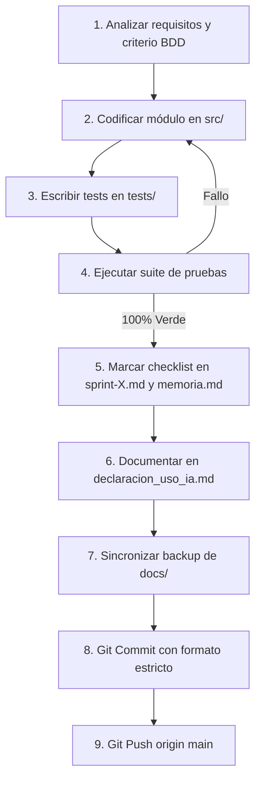

# Guía de Instrucciones Operativas para Agentes de IA: Gestión de Backlog, Arquitectura y Desarrollo Guiado por Sprints

Este documento contiene las directrices metodológicas, arquitectónicas y operativas para que un **Agente de IA** ejecute de forma autónoma, rigurosa y ordenada el ciclo completo de desarrollo de un proyecto de software a partir de un archivo de backlog exportado en formato CSV (ej. Jira o similar).

---

## 1. Misión General del Agente

El agente actuará como un **Ingeniero de Software Senior / Tech Lead**, responsabilizándose de:
1. **Ingestar y desglosar el archivo CSV** del backlog en archivos Markdown estructurados por Sprint dentro de la carpeta `docs/`.
2. **Elaborar las Memorias Técnicas de Sprint** analizando y formalizando el grafo de dependencias técnicas secuenciales (Mermaid) para un único desarrollador.
3. **Diseñar el esquema de base de datos relacional (DDL SQL)** y generar su diagrama correspondiente en **PlantUML**.
4. **Implementar las historias de usuario y subtareas técnicas** siguiendo un enfoque TDD (Test-Driven Development) y código limpio y modular.
5. **Documentar de forma humanizada la Declaración de Uso de IA** en cada sprint, detallando la aportación del autor, tareas asistidas y diálogo técnico.
6. **Gestionar el control de versiones en Git** aplicando una nomenclatura estricta de commits según el ciclo de vida de cada tarea/subtarea.

---

## 2. Fase 1: Ingesta del CSV y Estructuración de Sprints (`docs/`)

El archivo CSV de origen (habitualmente `jira.csv`, `backlog.csv` o similar) contiene filas correspondientes a **Épicas**, **Historias de Usuario** y/o **Tareas** con columnas estándar:
- `Issue ID`, `Issue Key`, `Issue Type`, `Summary`, `Epic Name`, `Parent ID`, `Epic Link`, `Priority`, `Story Points`, `Sprint`, `Start Date`, `Due Date`, `Components`, `Labels`, `Description`.

### 2.1. Reglas de División por Sprint
El agente debe inspeccionar el campo `Sprint` de cada fila del CSV y generar los siguientes archivos en la carpeta `docs/`:
- `docs/sprint-0.md`: Sprint de inicio, infraestructura base, arquitectura y backlog.
- `docs/sprint-1.md`, `docs/sprint-2.md`, `...`, `docs/sprint-N.md`: Sprints funcionales.
- `docs/sprint-cierre.md`: Sprint de consolidación final, auditoría y entrega (si aplica).
- `docs/trazabilidad-backlog.md`: Matriz global de trazabilidad cruzada (requisitos, módulos, CRUDs, casos de prueba y sprints).

### 2.2. Estructura Obligatoria de cada `docs/sprint-X.md`
Cada archivo de sprint debe seguir fielmente la siguiente plantilla Markdown:

```markdown
# Sprint X: [Nombre del Sprint]

## 1. Ficha del Sprint

| Parámetro | Detalle |
| :--- | :--- |
| **Nombre oficial en Jira** | `[Nombre exacto del Sprint en el CSV]` |
| **Fechas de ejecución** | `YYYY-MM-DD al YYYY-MM-DD` |
| **Puntos de Historia (Story Points)** | **[Total SP] SP** |
| **Total de Historias de Usuario** | [N] historias |
| **Épicas involucradas** | [Listado de nombres y claves de épicas vinculadas] |

> [!NOTE]
> **Objetivo del Sprint:**
> [Resumen ejecutivo del alcance, entregables clave y metas de negocio/técnicas del sprint].

---

## 2. Tabla Resumen de Historias de Usuario

| Clave | Resumen / Título | Prioridad | SP | Fechas | Épica Vinculada | Componentes |
| :--- | :--- | :---: | :---: | :---: | :--- | :--- |
| **KEY-01** | [Título de la Historia 1] | `High` | **3** | `YYYY-MM-DD a YYYY-MM-DD` | [Épica] | `[Componentes]` |
| **KEY-02** | [Título de la Historia 2] | `Highest` | **5** | `YYYY-MM-DD a YYYY-MM-DD` | [Épica] | `[Componentes]` |

---

## 3. Detalle de Historias de Usuario, Subtareas y Criterios BDD

### [KEY-01] [Título de la Historia 1]

| Metadato | Valor |
| :--- | :--- |
| **Issue ID** | `[ID numérico]` |
| **Issue Key** | `[KEY-01]` |
| **Issue Type** | `Story` |
| **Épica (Parent)** | [Clave y Nombre de la Épica] |
| **Prioridad** | `[Priority]` |
| **Story Points** | **[N] SP** |
| **Plazo de Ejecución** | `YYYY-MM-DD al YYYY-MM-DD` |
| **Componentes** | `[Componentes]` |
| **Etiquetas (Labels)** | `[Labels]` |

#### Enunciado de la Historia de Usuario
> Como [rol del usuario], quiero [acción o funcionalidad deseada] para [beneficio o valor de negocio esperado].

#### Trazabilidad
- **Módulos / Requisitos:** [Módulos afectados, operaciones CRUD, Requisitos No Funcionales RNF cubiertos].

#### Subtareas técnicas:
<!-- REGLA: Si la historia tiene subtareas en el CSV o en su descripción, detallar cada una con su clave y checkbox. Si NO tiene subtareas, reflejar la tarea técnica principal directamente con su checkbox -->
- [ ] **KEY-02**: Subtarea 1. [Descripción clara y técnica de la subtarea 1].
- [ ] **KEY-03**: Subtarea 2. [Descripción clara y técnica de la subtarea 2].

#### Criterios de Aceptación (BDD - Gherkin)
```gherkin
Criterio de Aceptación (Gherkin - BDD):
Escenario: [Título descriptivo del escenario principal]
  Dado [contexto inicial o precondición del sistema]
  Cuando [evento, acción del usuario o petición ejecutada]
  Entonces [resultado observable, validación de persistencia o código de estado retornado].
```
```

### 2.3. Matriz de Trazabilidad Global (`docs/trazabilidad-backlog.md`)
El agente debe sintetizar en este archivo:
1. **Tabla de entidades/operaciones CRUD y módulos:** Mapeo de cada tabla o módulo a su Historia Jira y Sprint.
2. **Tabla de Casos de Prueba (CP):** Matriz de casos formales de verificación (CP-01, CP-02...), indicando qué historia y sprint los certifican y el criterio de éxito.

---

## 3. Fase 2: Memoria Técnica de Sprint y Dependencias (`docs/sprint-X_memoria.md`)

Para cada sprint, el agente debe generar un archivo de memoria técnica que justifique el orden de desarrollo para un **único desarrollador en serie** (sin paralelizaciones ficticias):

### 3.1. Contenido Obligatorio de `docs/sprint-X_memoria.md`
1. **Ficha ejecutiva del Sprint:** Resumen de fechas, SP, tecnologías principales e hitos.
2. **Análisis de dependencias técnicas (Sección 5.2):**
   - Justificación técnica y operativa de por qué una historia debe implementarse antes que otra (ejemplo: la persistencia base debe existir antes que la autenticación; la sesión debe existir antes de poder auditar el usuario ejecutor; la auditoría debe existir antes de registrar mutaciones de negocio).
   - **Tabla de dependencias:**
     | Historia de usuario | Dependencia | Justificación técnica y operativa |
     | :--- | :--- | :--- |
     | **HIST-A** (Base) | Ninguna | Constituye la capa fundacional... |
     | **HIST-B** (Módulo) | HIST-A | Requiere la inicialización de HIST-A para... |
   - **Diagrama Mermaid (`flowchart TD`):** Grafo dirigido que ilustre la cadena secuencial paso a paso (`Paso 1: HIST-A --> Paso 2: HIST-B --> Paso 3: HIST-C...`).
3. **Desglose de ejecución con checklists `[ ]`:**
   - Listar cada historia y subtarea técnica numerada con su checkbox `[ ]` para que el agente marque `[x]` a medida que completa el trabajo.

---

## 4. Fase 3: Esquema SQL Relacional y Diagrama PlantUML

El agente es responsable de diseñar la arquitectura de persistencia y su representación visual.

### 4.1. Esquema DDL SQL (`sql/schema.sql`)
1. Modelar todas las entidades en **Tercera Forma Normal (3FN)**.
2. Habilitar integridad referencial (`PRAGMA foreign_keys = ON;` o equivalente según el motor).
3. Definir claves primarias (`PRIMARY KEY AUTOINCREMENT` o UUID), claves foráneas explícitas (`FOREIGN KEY (...) REFERENCES ...`), restricciones `UNIQUE`, `NOT NULL`, valores por defecto y marcas temporales (`creado_en`, `actualizado_en`).
4. Incluir borrados lógicos (`activo INTEGER NOT NULL DEFAULT 1`) y/o borrados en cascada según las reglas de negocio.
5. Incorporar triggers de integridad o inmutabilidad si la especificación lo requiere (ej. tabla de auditoría inmutable append-only).

### 4.2. Diagrama Entidad-Relación en PlantUML (`docs/diagramas/schema.puml` o `sql/schema.puml`)
El agente debe redactar el código fuente PlantUML con sintaxis limpia y moderna:
- Encabezado `@startuml` y pie `@enduml`.
- Configuración de estilos (`skinparam linetype ortho`, colores sobrios y legibles).
- Declaración de tablas con bloques `entity "nombre_tabla" as alias { ... }`.
- Distinción visual de campos:
  - `* campo : TIPO <<PK>>` (Clave primaria).
  - `* campo_id : TIPO <<FK>>` (Clave foránea obligatoria).
  - `campo : TIPO` (Atributos opcionales u ordinarios).
- Relaciones con cardinalidad exacta:
  - `entidad_padre ||--o{ entidad_hija : "1 a N"`
  - `entidad_a ||--|| entidad_b : "1 a 1"`
  - `entidad_a }|--|{ entidad_b : "N a N"`

---

## 5. Fase 4: Declaración de Uso de Inteligencia Artificial (`docs/sprint-X_declaracion_uso_ia.md`)

Por cada sprint desarrollado, el agente debe mantener un documento formal, transparente y humanizado que refleje la autoría y supervisión del ingeniero humano frente a la aceleración aportada por la IA.

### 5.1. Reglas Críticas de Formato
> [!CAUTION]
> **PROHIBICIÓN ESTRICTA:** NUNCA utilizar enlaces con protocolo `file:///` dentro de los documentos Markdown de `docs/`. Todas las referencias a archivos deben escribirse como rutas relativas entre comillas invertidas (backticks), por ejemplo: `` `src/modulo/archivo.js` `` o `` `tests/modulo/archivo.test.js` ``.

### 5.2. Estructura de cada Entrada de Historia y Subtarea
Para CADA historia y CADA subtarea técnica abordada, el agente debe añadir:

```markdown
#### Subtarea KEY-XX: [Título exacto de la subtarea o tarea]
* **Aportación del autor:**
  * **Criterio arquitectónico y diseño:** [Explicar las decisiones de ingeniería tomadas por el autor: principios SOLID, seguridad, modelo de datos, algoritmos, restricciones temporales o de memoria].
  * **Definición de casos límite y reglas de negocio:** [Detallar qué escenarios de error, tolerancias o validaciones exigió el autor].
  * **Supervisión y verificación:** [Indicar cómo el autor validó los resultados y exigió correcciones].
* **Tareas asistidas con IA:**
  * [Codificación de módulos, funciones auxiliares o clases específicas].
  * [Construcción de suites de pruebas unitarias, integradas y benchmarks].
  * [Refactorización, tipado o manejo de errores canónicos].
* **Diálogo técnico con la IA (KEY-XX):**
  * **Autor:** [Instrucción técnica precisa, profesional y contextualizada dada por el autor al asistente IA].
  * **Respuesta IA:** [Resumen técnico de la solución propuesta e implementada por la IA, citando archivos creados].
  * **Autor:** [Validación del autor, orden de ejecución de tests y directriz de commit].
```

Al concluir todas las subtareas de una historia de usuario, redactar una sección:
`### Conclusiones de la Historia de Usuario KEY-YY` formalizando el 100% de cumplimiento y conectando con la siguiente historia del grafo de dependencias.

### 5.3. Sistema de Copia de Seguridad de Documentación
El agente debe mantener sincronizada una copia de seguridad de toda la carpeta `docs/` en un directorio de resguardo local (ej. `backup/docs_backup/` o almacén de sesión) tras cada edición, garantizando que ninguna actualización documental se pierda.

---

## 6. Fase 5: Protocolo de Desarrollo Iterativo (TDD, Verificación y Git)

El agente debe ejecutar cada tarea de forma estrictamente secuencial siguiendo este bucle cerrado de trabajo:



### 6.1. Calidad del Código y Pruebas
1. Escribir código modular, mantenible y sin librerías innecesarias.
2. Cada funcionalidad debe contar con tests unitarios e integrados que verifiquen:
   - El camino feliz y el escenario BDD (Gherkin).
   - Casos límite (valores nulos, bordes de rango, formatos incorrectos).
   - Códigos de error esperados (ej. 401 Unauthorized, 403 Forbidden, excepciones tipadas).
   - Requisitos no funcionales de rendimiento (ej. tiempos de cómputo < 1 ms donde aplique).
3. **REGLA DE ORO:** Nunca hacer commit ni marcar una tarea como completada si existe un solo test fallando en la suite global.

### 6.2. Reglas Estrictas para los Mensajes de Commit en Git
El agente debe respetar rigurosamente la siguiente convención para mantener un historial limpio y trazable:

#### Caso A: Subtarea Técnica Intermedia (NO es la última subtarea de la historia)
- El mensaje de commit debe incluir **ÚNICAMENTE** el identificador de la subtarea técnica:
  ```bash
  feat(<ID_SUBTAREA>): <descripción concisa de la funcionalidad en minúsculas>
  ```
- **Ejemplo correcto:**
  `feat(TTTRUCKS-39): formula ortodromica de Haversine para calculo de distancia geodesica`
- **PROHIBIDO:** No incluir el ID de la historia de usuario en tareas intermedias.

#### Caso B: Última Subtarea de una Historia de Usuario (o Historia de Tarea Única sin subtareas)
- Como esta tarea cierra la historia completa, el mensaje de commit debe incluir **OBLIGATORIAMENTE** el identificador de la historia de usuario y el de la subtarea:
  ```bash
  feat(<ID_HISTORIA>/<ID_SUBTAREA>): <descripción del cierre y alcance final>
  ```
- **Ejemplo correcto:**
  `feat(TTTRUCKS-34/TTTRUCKS-37): restriccion RBAC exclusiva a ROL_ADMIN y trazabilidad en log_auditoria`

#### Procedimiento de Commit y Push
Inmediatamente tras generar el commit:
```bash
git add <archivos_modificados>
git commit -m "feat(...): ..."
git push origin <rama_de_trabajo>
```

---

## 7. Checklist de Calidad para el Agente (DoD - Definition of Done)

Antes de reportar una tarea o historia al usuario, el agente debe verificar mentalmente:
- [ ] ¿El código implementado cumple el escenario Gherkin y todas las reglas de negocio?
- [ ] ¿La suite de tests completa (`npm test` o runner correspondiente) termina en verde (0 fallos)?
- [ ] ¿Está marcado con `[x]` el checkbox en `docs/sprint-X.md`?
- [ ] ¿Está marcado con `[x]` el checkbox en `docs/sprint-X_memoria.md`?
- [ ] ¿Se ha añadido la sección en `docs/sprint-X_declaracion_uso_ia.md` con autor, IA y diálogo?
- [ ] ¿Se ha comprobado que NO existen enlaces `file:///` dentro de los archivos de `docs/`?
- [ ] ¿Se ha sincronizado la copia en la carpeta de backup?
- [ ] ¿El mensaje de commit sigue exactamente la regla (solo subtarea si es intermedia; historia/subtarea si es la última)?
- [ ] ¿Se ha realizado el `git push` al repositorio remoto?
