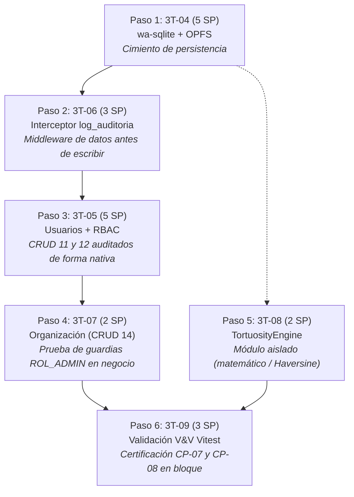

# Memoria Técnica de Planificación y Estructura — Sprint 1

## 1. Ficha General del Sprint 1

| Parámetro | Detalle |
| :--- | :--- |
| **Nombre del Sprint** | Sprint 1 (BBDD, RBAC, Auditoría y Organización) |
| **Periodo oficial** | `12/11/2026 al 25/11/2026` |
| **Story Points totales** | **20 SP** |
| **Historias de Usuario** | 6 historias (`3T-04` a `3T-09`) |
| **Épicas cubiertas** | `3T-EP1` (Local-First y RBAC), `3T-EP2` (Cartografía/Flota), `3T-EP6` (V&V Vitest) |
| **Objetivo central** | Desplegar el motor SQLite WASM en navegador sobre OPFS, asentar la capa de auditoría automática inmutable, el control de acceso por roles (RBAC) y preparar el algoritmo preliminar de cálculo vial. |

---

## 2. Reordenación Técnica Optimizada del Sprint

Para evitar retrabajos y refactorizaciones intermedias, se adopta una **secuencia de desarrollo guiada por dependencias arquitectónicas**, alterando el orden numérico estricto de los tickets:

### Justificación del cambio de orden:
1. **`3T-04` primero:** Proporciona el Web Worker y el adaptador transaccional sin el cual ninguna entidad puede persistir.
2. **`3T-06` antes de `3T-05`:** Construir el interceptor de auditoría como middleware de la capa de datos asegura que cuando se desarrollen los usuarios y roles (`3T-05`), cada inserción o cambio de clave quede registrado automáticamente sin tener que volver a tocar el código después.
3. **`3T-05` antes de `3T-07`:** El CRUD de organización exige validar que quien edita tiene `ROL_ADMIN`. Por tanto, el módulo de roles y guardias de sesión debe existir previamente.
4. **`3T-08` desacoplado:** Algoritmo puramente matemático (distancia ortodrómica ponderada) sin acoplamiento a base de datos. Se implementa de forma independiente preparando el Sprint 2.
5. **`3T-09` como cierre:** Batería automatizada de pruebas formales (CP-07 y CP-08) que valida el conjunto integrado.

---

## 3. Detalle de Historias en la Secuencia Optimizada

### [Paso 1] 3T-04: Motor de persistencia Local-First (wa-sqlite sobre OPFS)
* **ID:** 4 | **Prioridad:** `Highest` | **Story Points:** `5 SP`
* **Módulos / RNF:** M04, RNF-01 (Offline), RNF-05 (Modularidad ES2024).
* **Enunciado:** Como usuario, quiero que la base de datos relacional se ejecute y persista directamente en el navegador mediante wa-sqlite y Origin Private File System (OPFS) para operar con latencia nula y disponibilidad offline.
* **Subtareas técnicas:**
  - [ ] **Subtarea 1:** Integrar el binario WebAssembly de `wa-sqlite` mediante Web Worker dedicado con sistema de archivos virtual sobre OPFS.
  - [ ] **Subtarea 2:** Implementar el gestor de transacciones SQLite asíncrono y el bootstrapping automático del esquema de 15 tablas (`sql/schema.sql`).
* **Criterio BDD:** Persistencia comprobada tras recarga de página o reinicio del navegador.

---

### [Paso 2] 3T-06: Interceptor Transaccional de Auditoría Inmutable (CRUD 13 - Capa Core)
* **ID:** 6 | **Prioridad:** `High` | **Story Points:** `3 SP`
* **Módulos / RNF:** M09, CRUD 13 (`log_auditoria`), RNF-06 (Trazabilidad estricta).
* **Enunciado:** Como Administrador, quiero que un interceptor en la capa de datos registre de forma desasistida e inmutable (append-only) cada operación INSERT, UPDATE, DELETE y LOGIN en la tabla `log_auditoria`.
* **Subtareas técnicas:**
  - [ ] **Subtarea 1:** Programar el interceptor transaccional que capture `id_log`, `id_usuario`, `username`, `rol_ejecutor`, acción (INSERT, UPDATE, DELETE, LOGIN), entidad, `id_registro`, diff JSON (`valor_anterior`, `valor_nuevo`), `timestamp_utc` y `origen_sesion`.
  - [ ] **Subtarea 2:** Bloquear en la capa de datos cualquier intento de modificación o borrado directo por operadores sobre `log_auditoria`.
* **Criterio BDD:** Inserción automática y síncrona en `log_auditoria` con diff JSON en cada mutación de datos.

---

### [Paso 3] 3T-05: Usuarios, Autenticación Criptográfica y Roles RBAC (CRUD 11 y CRUD 12)
* **ID:** 5 | **Prioridad:** `Highest` | **Story Points:** `5 SP`
* **Módulos / RNF:** M09, CRUD 11 (`usuario`), CRUD 12 (`rol_permiso`), RNF-07 (Seguridad).
* **Enunciado:** Como Administrador, quiero gestionar el ciclo de vida de los usuarios y los permisos de los roles (ROL_ADMIN y ROL_CONDUCTOR) con contraseñas protegidas mediante SHA-256 y salt único.
* **Subtareas técnicas:**
  - [ ] **Subtarea 1 (CRUD 11):** Alta con SHA-256 + salt y rol, listado con último login, edición de perfil y baja lógica.
  - [ ] **Subtarea 2 (CRUD 12):** Matriz granular de privilegios (lectura/escritura por módulo y rol).
  - [ ] **Subtarea 3:** Guardias de autorización en el enrutador de vistas UI y en el adaptador SQLite (bloqueo 403).
* **Criterio BDD:** Un usuario con `ROL_CONDUCTOR` que intente escribir en `usuario` o `rol_permiso` recibe un bloqueo visual y excepción de autorización en la capa de datos.

---

### [Paso 4] 3T-07: Configuración Corporativa de la Organización (CRUD 14)
* **ID:** 7 | **Prioridad:** `Medium` | **Story Points:** `2 SP`
* **Módulos / RNF:** M10, CRUD 14 (`organizacion`).
* **Enunciado:** Como Administrador, quiero gestionar los datos fiscales y corporativos de la empresa para alimentar el perfil de flota y las cabeceras de informes.
* **Subtareas técnicas:**
  - [ ] **Subtarea 1 (CRUD 14):** Formulario y persistencia de CIF, razón social, dirección, contacto y logotipo.
  - [ ] **Subtarea 2:** Restricción de acceso y modificación exclusivamente para `ROL_ADMIN`.
* **Criterio BDD:** Edición correcta por parte del administrador, persistencia en BBDD y registro automático generado en `log_auditoria`.

---

### [Paso 5] 3T-08: Algoritmo de Estimación Vial Instantánea (TortuosityEngine)
* **ID:** 8 | **Prioridad:** `High` | **Story Points:** `2 SP`
* **Módulos / RNF:** M01 (Cartografía - Fase preliminar).
* **Enunciado:** Como planificador, quiero una estimación preliminar en menos de 1 ms de la distancia y tiempo entre coordenadas aplicando tortuosidad geométrica antes de solicitar la ruta al VPS OSRM.
* **Subtareas técnicas:**
  - [ ] **Subtarea 1:** Implementar el cálculo ortodrómico (Haversine) ponderado por el factor de tortuosidad peninsular.
  - [ ] **Subtarea 2:** Contemplar casos límite (coordenadas idénticas, distancia 0 y puntos insulares sin paso terrestre).
* **Criterio BDD:** Respuesta calculada en < 1 ms con control de casos límite.

---

### [Paso 6] 3T-09: [VALIDACIÓN S1] Pruebas Automatizadas de Seguridad, Auditoría y Tortuosity (CP-07 y CP-08)
* **ID:** 9 | **Prioridad:** `Highest` | **Story Points:** `3 SP`
* **Módulos / RNF:** Sección 11 (V&V), CP-07 y CP-08.
* **Enunciado:** Como ingeniero de V&V, quiero certificar mediante Vitest la segregación RBAC, la inmutabilidad de la auditoría y los casos límite de TortuosityEngine.
* **Subtareas de validación:**
  - [ ] **Subtarea 1 (CP-07):** Test automatizado de intento de acceso no autorizado con rol Conductor.
  - [ ] **Subtarea 2 (CP-08):** Test automatizado de generación síncrona en `log_auditoria` con diff JSON y hora UTC.
  - [ ] **Subtarea 3:** Tests unitarios de precisión y tiempos de respuesta de `TortuosityEngine`.
* **Criterio BDD:** 100% de pruebas en verde confirmando el bloqueo de seguridad y la trazabilidad inmutable.
